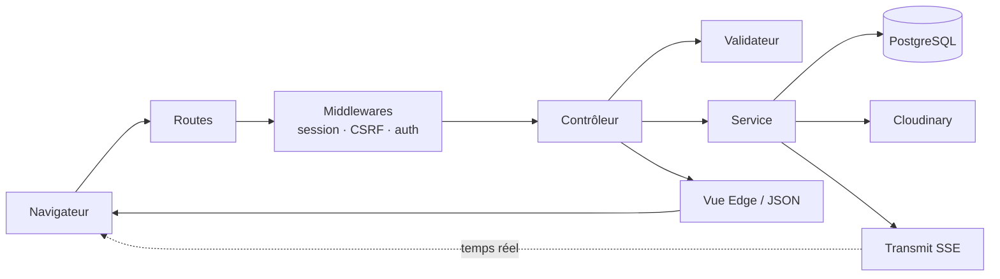
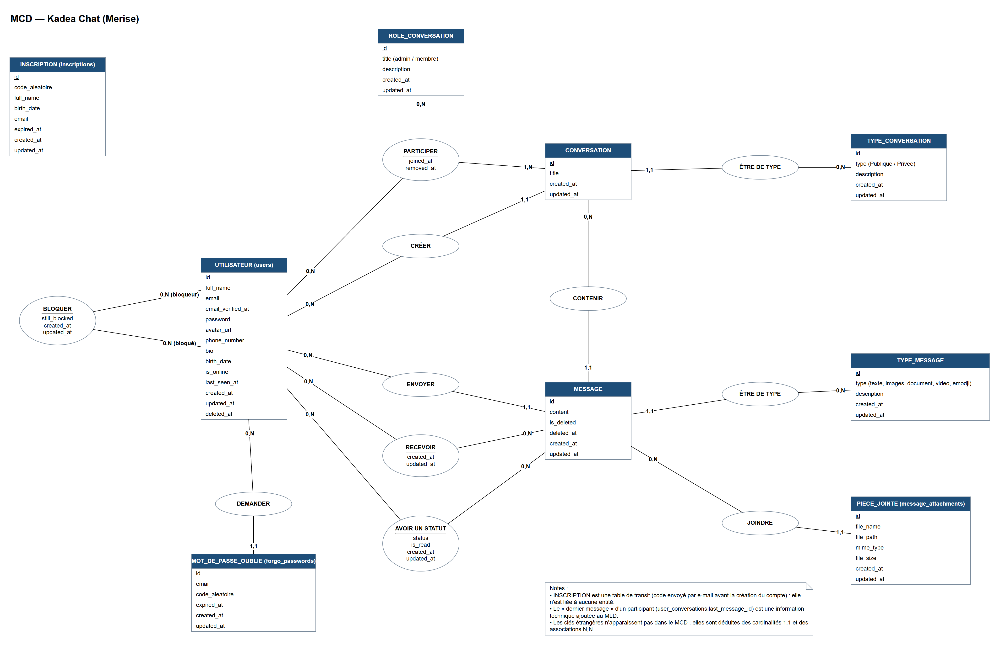
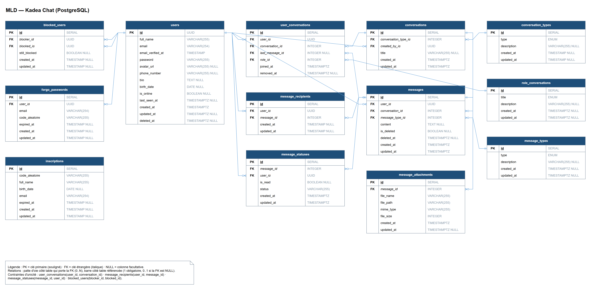
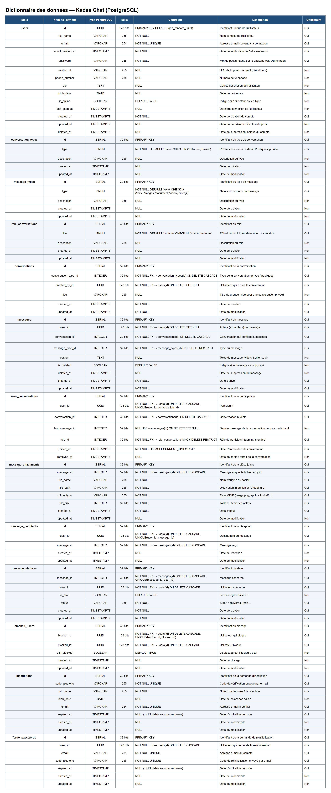

<div align="center">

# Kadea Chat

**Application web de messagerie : discussions privées, groupes et temps réel.**

Projet de fin de formation · Kadea Academy


[Démo en ligne](#liens-du-projet) · [Vidéo](https://youtu.be/tYmT7e_5RL4) · [Présentation](#liens-du-projet) · [Modélisation](#liens-du-projet) · [Architecture C4](#liens-du-projet) · [Installation](#installation)

</div>

---

## Sommaire

1. [Liens du projet](#liens-du-projet)
2. [Présentation](#présentation)
3. [Fonctionnalités](#fonctionnalités)
4. [Technologies](#technologies)
5. [Architecture](#architecture)
6. [Prérequis](#prérequis)
7. [Installation](#installation)
8. [Variables d'environnement](#variables-denvironnement)
9. [Commandes utiles](#commandes-utiles)
10. [Structure du projet](#structure-du-projet)
11. [Routes principales](#routes-principales)
12. [Base de données](#base-de-données)
13. [Sécurité](#sécurité)
14. [Tests](#tests)
15. [Déploiement](#déploiement)
16. [Problèmes fréquents](#problèmes-fréquents)
17. [Limites connues et évolutions](#limites-connues-et-évolutions)
18. [Usage de l'intelligence artificielle](#usage-de-lintelligence-artificielle)
19. [Auteur](#auteur)

---

## Liens du projet

| Ressource | Lien |
|---|---|
| Site en ligne | [`https://agora-chat-app-1.onrender.com`](https://agora-chat-app-1.onrender.com/) |
| Présentation (Canva) | [`Diaporama de soutenance`](https://www.canva.com/design/DAHZPdEXD74/efmBfAdAlk039St4dMZBMw/view) |
| Maquettes (Figma) | [`Kadea Chat`](https://www.figma.com/design/hTThi75OAXNNjJtiz2gVSU/Kadea-Chat-Final?node-id=0-1&p=f&t=Tgk3rswckWaMcmbz-0) |
| Modélisation (dictionnaire / MCD / MLD) | [`docs/modelisation`](docs/modelisation) ou [`version interactive (draw.io)`](https://viewer.diagrams.net/?nav=1&title=Kadea%20Chat%20-%20Mod%C3%A9lisation#Uhttps%3A%2F%2Fraw.githubusercontent.com%2FJoelMitondo%2FKadea_Chat_App%2Fmain%2Fdocs%2Fmodelisation%2Fkadea_chat_modelisation.drawio) |
| Architecture C4 (Structurizr) | [`docs/c4/workspace.dsl`](docs/c4/workspace.dsl) ou [`voir les diagrammes en ligne`](https://playground.structurizr.com/?src=https://raw.githubusercontent.com/JoelMitondo/Kadea_Chat_App/main/docs/c4/workspace.dsl) |
| Vidéo de démonstration (secours) | [`Voir sur YouTube`](https://youtu.be/tYmT7e_5RL4) — toutes les procédures en 4 min 20 |


---

## Présentation

**Kadea Chat** est une application de messagerie web conçue de A à Z : analyse, modélisation de la base de données, serveur, interface, sécurité et temps réel.

**Objectifs du projet**

- Proposer un espace de discussion simple pour une communauté (promotion, classe, équipe).
- Couvrir tout le cycle de développement : conception, base de données, serveur, interface, déploiement.
- Appliquer des règles de sécurité côté serveur (droits, validation, protection des comptes).

---

## Fonctionnalités

| Domaine | Détail |
|---|---|
| **Comptes** | Inscription en deux étapes avec confirmation par e-mail, connexion, mot de passe oublié par lien à usage unique |
| **Profil** | Photo, biographie, statut « En ligne », statistiques |
| **Messages privés** | Envoi, modification, suppression (le texte est effacé de la base), statuts envoyé / reçu / lu, historique complet (« messages précédents » par pages de 50), compteur de non-lus, suppression de conversation pour soi |
| **Groupes** | Création, rôles administrateur / membre, ajout et retrait de membres par l'administrateur, suppression du groupe |
| **Temps réel** | Nouveaux messages, réceptions, lectures, modifications et présence instantanés (SSE) |
| **Fichiers joints** | Images et documents jusqu'à 10 Mo, miniatures, ouverture et téléchargement |
| **Recherche** | Dans tous ses propres messages, avec mot surligné |
| **Utilisateurs** | Liste paginée, recherche, démarrage d'une discussion |
| **Blocage** | Un utilisateur bloqué ne peut plus écrire à celui qui l'a bloqué |
| **Paramètres** | Changement de mot de passe (ancien + nouveau + confirmation, ou lien par e-mail), liste des bloqués, suppression de compte avec règles de succession |
| **Interface** | Responsive (ordinateur et téléphone), chargeur, notifications, états vides, pages d'erreur |

---

## Technologies

| Couche | Outil | Rôle |
|---|---|---|
| Serveur | **AdonisJS 7** (TypeScript) | Routes, validation, authentification, sessions |
| Gabarits | **Edge** | Génération des pages HTML |
| Base de données | **PostgreSQL** + **Lucid** (ORM) | Stockage et requêtes |
| Validation | **VineJS** | Contrôle des données reçues |
| Styles | **Tailwind CSS 4** | Mise en forme (identité visuelle Kadea Chat) |
| Interface | **JavaScript (modules)** + **Vite** | Interactions dans le navigateur |
| Temps réel | **Transmit** (Server-Sent Events) | Messages et présence instantanés |
| Fichiers | **Cloudinary** | Stockage des images et documents |
| E-mails | **Brevo** | Confirmation d'inscription, mot de passe oublié |
| Tests | **Japa** | Tests unitaires et fonctionnels |

---

## Architecture

### Parcours d'une requête



### Responsabilités

| Couche | Dossier | Rôle |
|---|---|---|
| Routes | `start/routes.ts` | Associer une adresse à une action, avec ses protections |
| Middlewares | `app/middleware/` | Autoriser ou refuser la suite de la requête |
| Validateurs | `app/validators/` | Vérifier la forme des données |
| Contrôleurs | `app/controllers/` | Orchestrer une action |
| Policies | `app/policies/` | Décider qui a le droit de faire quoi (Bouncer) |
| Services | `app/services/` (alias `#services/...`) | Règles métier réutilisables |
| E-mails | `app/mails/` + `resources/views/emails/` | Contenu des e-mails envoyés |
| Modèles | `app/models/` | Tables et relations |
| Vues | `resources/views/` | Affichage (layouts, composants, partiels) |
| Scripts | `resources/js/` | Comportements côté navigateur |

### Modèle C4

L'architecture est décrite avec le [modèle C4](https://c4model.com) et l'outil [Structurizr](https://structurizr.com). La source unique est [`docs/c4/workspace.dsl`](docs/c4/workspace.dsl). Elle produit trois vues :

| Niveau | Vue | Ce qu'elle montre |
|---|---|---|
| 1 | Contexte | L'utilisateur, Kadea Chat et les services externes (Cloudinary, Brevo) |
| 2 | Conteneurs | Navigateur, application AdonisJS, base PostgreSQL, et les protocoles (HTTPS, SSE, SQL) |
| 3 | Composants | L'intérieur d'AdonisJS : controllers, auth, services, temps réel, modèles Lucid |

**[Ouvrir les diagrammes C4 en ligne](https://playground.structurizr.com/?src=https://raw.githubusercontent.com/JoelMitondo/Kadea_Chat_App/main/docs/c4/workspace.dsl)** (choisir la vue dans la liste en bas du playground).

---

## Prérequis

| Outil | Version | Vérification |
|---|---|---|
| Node.js | **24 ou plus** | `node -v` |
| npm | fourni avec Node | `npm -v` |
| PostgreSQL | 14 ou plus | `psql --version` |
| Git | récent | `git --version` |
| Compte Cloudinary | gratuit | [cloudinary.com](https://cloudinary.com) |
| Compte Brevo | gratuit | [brevo.com](https://www.brevo.com) |

---

## Installation

### 1. Récupérer le projet

```bash
git clone https://github.com/JoelMitondo/Kadea_Chat_App.git
cd Kadea_Chat_App
```

### 2. Installer les dépendances

```bash
npm ci
```

### 3. Créer la base de données

```bash
psql -U postgres
```

```sql
CREATE DATABASE kadea_chat;
CREATE DATABASE kadea_chat_test;   -- pour les tests, jamais la même base
\q
```

### 4. Configurer l'environnement

```bash
cp .env.example .env
node ace generate:key
```

La seconde commande écrit une valeur `APP_KEY` unique dans `.env`. Complétez ensuite le fichier en suivant la section [Variables d'environnement](#variables-denvironnement).

### 5. Créer les tables et les données de référence

```bash
node ace migration:run
node ace db:seed
```

Deux seeders se trouvent dans `database/seeders/` :

| Seeder | Environnements | Contenu |
|---|---|---|
| `01_reference_data_seeder.ts` | tous (y compris production) | Types de conversation (`Privee`, `Publique` = groupe), rôles (`admin`, `membre`), types de message (`texte`, `images`, `document`, `video`, `emodji`) |
| `02_demo_users_seeder.ts` | **développement uniquement** | Quatre comptes de démonstration déjà confirmés (voir ci-dessous) |

Les seeders sont rejouables : relancer `node ace db:seed` ne crée pas de doublons.

**Comptes de démonstration (local uniquement)** : `amina@example.com`, `benjamin@example.com`, `chloe@example.com`, `david@example.com`, mot de passe `KadeaDemo2026`. Ils ne sont **jamais** créés en production : sur le site hébergé, les comptes se créent par l'inscription avec confirmation par e-mail.

### 6. Lancer l'application

Ouvrez **deux terminaux** :

```bash
# Terminal 1 : serveur AdonisJS + Vite (rechargement à chaud)
npm run dev
```

```bash
# Terminal 2 : génération des styles Tailwind
npx @tailwindcss/cli -i ./resources/css/input.css -o ./resources/css/output.css --watch
```

L'application est disponible sur **http://localhost:3333**.

> Si une classe Tailwind « ne fonctionne pas », le terminal 2 n'est presque toujours pas lancé.

### 7. Premier test rapide

1. Ouvrez `/register`, créez un compte.
2. Cliquez sur le lien reçu par e-mail pour finaliser.
3. Créez un second compte dans une fenêtre de navigation privée.
4. Envoyez un message d'un compte à l'autre : il doit arriver sans recharger la page.

---

## Variables d'environnement

Copiez `.env.example` vers `.env`, puis renseignez :

```dotenv
# Node
TZ=UTC
PORT=3333
HOST=localhost
NODE_ENV=development

# Application
LOG_LEVEL=info
APP_KEY=                      # généré par `node ace generate:key`
APP_URL=http://localhost:3333

# Session
SESSION_DRIVER=cookie

# Base de données PostgreSQL
DB_HOST=127.0.0.1
DB_PORT=5432
DB_USER=postgres
DB_PASSWORD=votre_mot_de_passe
DB_DATABASE=kadea_chat

# E-mails (Brevo)
MAIL_MAILER=brevo
MAIL_FROM_NAME=Kadea Chat
MAIL_FROM_ADDRESS=adresse-verifiee@exemple.com
BREVO_API_KEY=votre_cle_brevo

# Cloudinary
CLOUDINARY_CLOUD_NAME=votre_cloud
CLOUDINARY_API_KEY=votre_cle
CLOUDINARY_API_SECRET=votre_secret

# Limiteur de requêtes (facultatif, "database" par défaut)
LIMITER_STORE=database
```

| Variable | Rôle | Remarque |
|---|---|---|
| `APP_KEY` | Chiffrement des cookies et sessions | Unique par environnement, jamais partagée |
| `APP_URL` | Adresse publique, base de **tous** les liens envoyés par e-mail | En production : l'adresse réelle en `https://` (ex. `https://agora-chat-app-1.onrender.com`). Les liens ne sont jamais construits à partir de l'en-tête `Host` de la requête |
| `SESSION_DRIVER` | `cookie`, `database` ou `memory` | `memory` est réservé aux tests |
| `MAIL_FROM_ADDRESS` | Expéditeur de **tous** les e-mails (lu dans `config/mail.ts`) | Doit être **vérifiée** dans Brevo. Idéalement une adresse d'un domaine à soi (SPF/DKIM configurés) : une adresse Gmail envoyée par Brevo arrive souvent dans les spams |
| `BREVO_API_KEY` | Clé d'API Brevo | Brevo → SMTP & API → Clés d'API |
| `CLOUDINARY_*` | Identifiants Cloudinary | Console Cloudinary → Tableau de bord |
| `LIMITER_STORE` | Où le limiteur garde ses compteurs : `database` (table `rate_limits`) ou `memory` | Facultatif. `memory` est utilisé par les tests |

> **Ne commitez jamais `.env`.** Il est déjà dans `.gitignore`. Si un secret a été publié par erreur, **changez-le** : le supprimer de l'historique Git ne suffit pas.

Toute nouvelle variable doit aussi être déclarée dans `start/env.ts`, sinon le démarrage ne la valide pas.

---

## Commandes utiles

| Commande | Effet |
|---|---|
| `npm run dev` | Serveur de développement avec rechargement à chaud |
| `npm run build` | Compilation pour la production (dossier `build/`) |
| `npm start` | Lancement du serveur compilé |
| `npm run lint` | Analyse du code (ESLint) |
| `npm run format` | Mise en forme (Prettier) |
| `npm run typecheck` | Vérification des types TypeScript |
| `npm test` | Tous les tests |
| `node ace test unit` | Tests unitaires seulement |
| `node ace migration:run` | Appliquer les migrations |
| `node ace migration:rollback` | Annuler le dernier lot de migrations |
| `node ace migration:fresh --seed` | **Efface tout** et reconstruit la base (développement uniquement) |
| `node ace db:seed` | Insérer les données de référence |
| `node ace list:routes` | Afficher toutes les routes |
| `node ace make:controller nom` | Générer un contrôleur |

---

## Structure du projet

```
kadea-chat/
├── app/
│   ├── controllers/        Un contrôleur par domaine (messages, groupes…)
│   ├── middleware/         auth, guest, auth silencieuse, liaisons du conteneur
│   ├── models/             Modèles Lucid (users, conversations, messages…)
│   ├── services/           Règles métier (Cloudinary, temps réel, groupes, suppression…)
│   ├── policies/           Autorisations Bouncer (ConversationPolicy, GroupPolicy)
│   ├── mails/              Classes d'e-mails (le contenu est dans resources/views/emails/)
│   ├── validators/         Schémas VineJS
│   └── exceptions/         Gestionnaire d'erreurs et pages 404 / 500
├── config/                 Réglages (base, session, hash, mail, Transmit, shield…)
├── database/
│   ├── migrations/         Création et évolution des tables
│   └── seeders/            Données de référence + comptes de démo (dev)
├── docs/
│   ├── modelisation/       Dictionnaire, MCD, MLD (.drawio, .svg, .png)
│   └── c4/                 Diagrammes C4 (contexte, conteneurs, composants)
├── resources/
│   ├── css/                input.css (thème) → output.css (généré)
│   ├── js/                 Scripts de pages et temps réel (modules Vite)
│   └── views/
│       ├── components/     Composants réutilisables (layouts, bulles, avatars…)
│       ├── partials/       Fragments renvoyés par le serveur (panneaux de chat)
│       └── pages/          Pages complètes
├── start/                  routes, kernel, limiter, validator, view, transmit
├── tests/                  functional/ (accès, policies, historique, sécurité, mot de passe) + helpers.ts
├── adonisrc.ts             Providers, preloads, suites de tests
└── vite.config.ts          Points d'entrée JavaScript
```

---

## Routes principales

| Méthode | Route | Rôle | Accès |
|---|---|---|---|
| GET / POST | `/register` | Inscription (5 envois d'e-mail / 15 min par IP) | Invité |
| GET / POST | `/signup/:id/:code` | Finalisation du compte | Invité |
| GET / POST | `/login` | Connexion (5 essais / min, puis 5 min de blocage), puis arrivée sur `/messages` | Invité |
| GET / POST | `/forgoPassword` | Demande de réinitialisation (5 envois / 15 min par IP) | Invité |
| GET / POST | `/forgoPassword/:id/:code` | Nouveau mot de passe | Invité |
| POST | `/logout` | Déconnexion | Connecté |
| GET | `/messages` | Liste des conversations privées | Connecté |
| GET / DELETE | `/conversations/:id` | Ouvrir / supprimer pour soi | Participant |
| GET | `/conversations/:id/messages?before=` | Messages précédents (JSON, 50 par page) | Participant |
| POST | `/conversations/:id/messages` | Envoyer (texte et/ou fichier) | Participant |
| PUT / DELETE | `/messages/:id` | Modifier / supprimer | Auteur |
| POST | `/conversations/:id/read` | Marquer comme lu | Participant |
| GET / POST | `/groups` | Liste / création | Connecté |
| GET / DELETE | `/groups/:id` | Ouvrir / supprimer | Membre / admin |
| GET | `/groups/:id/messages?before=` | Messages précédents du groupe (JSON) | Membre |
| GET | `/groups/candidates?q=&group=` | Recherche des personnes à ajouter (20 au plus) | Connecté / membre |
| POST | `/groups/:id/members` | Ajouter des membres | Admin |
| DELETE | `/groups/:id/members/:userId` | Retirer un membre | Admin |
| POST | `/groups/:id/messages` | Écrire dans un groupe | Membre |
| GET | `/users` | Liste et recherche d'utilisateurs | Connecté |
| POST | `/users/:id/chat` | Démarrer une discussion | Connecté |
| POST | `/users/:id/block` · `/unblock` | Bloquer / débloquer | Connecté |
| GET | `/search?q=` | Rechercher dans ses messages | Connecté |
| GET / POST | `/profile` | Voir / modifier le profil | Connecté |
| GET | `/settings` | Paramètres du compte | Connecté |
| POST | `/settings/password` | Changer son mot de passe (ancien redemandé) | Connecté |

Les `:id` de conversation, de groupe et de message n'acceptent que des nombres, et les `:id` d'utilisateur que des uuid : `/conversations/abc` renvoie une 404, jamais une erreur 500.

La liste exacte et à jour s'obtient avec `node ace list:routes`.

---

## Base de données

La modélisation suit la méthode Merise et correspond aux migrations de `database/migrations/`. Seule la table technique `rate_limits` (compteurs du limiteur de requêtes, gérée par `@adonisjs/limiter`) n'y figure pas : elle ne fait pas partie du domaine métier.

| Document | Image | Fichier source |
|---|---|---|
| Dictionnaire des données (13 tables, 92 attributs) | [PNG](docs/modelisation/dictionnaire_donnees.png) · [SVG](docs/modelisation/dictionnaire_donnees.svg) | [`kadea_chat_modelisation.drawio`](docs/modelisation/kadea_chat_modelisation.drawio) |
| MCD — modèle conceptuel | [PNG](docs/modelisation/mcd.png) · [SVG](docs/modelisation/mcd.svg) | même fichier, page « MCD » |
| MLD — modèle logique | [PNG](docs/modelisation/mld.png) · [SVG](docs/modelisation/mld.svg) | même fichier, page « MLD » |

- **Version interactive** (zoom, navigation entre les pages, sans compte) : [ouvrir dans draw.io](https://viewer.diagrams.net/?nav=1&title=Kadea%20Chat%20-%20Mod%C3%A9lisation#Uhttps%3A%2F%2Fraw.githubusercontent.com%2FJoelMitondo%2FKadea_Chat_App%2Fmain%2Fdocs%2Fmodelisation%2Fkadea_chat_modelisation.drawio). Le lien lit le fichier `.drawio` de la branche `main` : il fonctionne dès que le dépôt est public.
- **Modifier les schémas** : ouvrir `kadea_chat_modelisation.drawio` sur [app.diagrams.net](https://app.diagrams.net) (*Fichier → Ouvrir depuis → Cet appareil*) ou avec l'extension VS Code « Draw.io Integration ».

### MCD



### MLD



<details>
<summary><b>Dictionnaire des données</b> (cliquer pour afficher)</summary>



</details>

### Rôle de chaque table

| Table | Contenu |
|---|---|
| `users` | Comptes utilisateurs, statut en ligne |
| `inscriptions` | Inscriptions en attente de confirmation (temporaire) |
| `forgo_passwords` | Demandes de réinitialisation (jeton haché, expiration) |
| `conversation_types` | Référence : `Privee` (à deux), `Publique` (groupe) |
| `conversations` | Discussions privées et groupes (même table) |
| `role_conversations` | Référence : `admin`, `membre` |
| `user_conversations` | Participants, rôle, date d'arrivée, dernier message lu |
| `message_types` | Référence : texte, images, document… |
| `messages` | Messages, suppression douce (`is_deleted`) |
| `message_attachments` | Fichiers joints (nom, lien, type, taille) |
| `message_statuses` | Statut de chaque message pour chaque destinataire : `sent` (envoyé) → `delivered` (reçu sur son appareil) → `read` (lu) |
| `message_recipients` | **Réservée à une évolution, non utilisée** : les statuts par destinataire (envoyé, reçu, lu) sont dans `message_statuses`. Elle est prévue pour des destinataires explicites, par exemple une réponse adressée à une partie seulement des membres d'un groupe |
| `blocked_users` | Qui a bloqué qui |

**Choix de conception**

- Un seul modèle pour les conversations privées **et** les groupes.
- Les rôles sont stockés dans la table de liaison `user_conversations`.
- Une migration déjà appliquée n'est jamais modifiée : on en écrit une nouvelle (exemple : `1793902700000_fix_foreign_keys_and_add_indexes.ts`).
- Suppression d'un compte : ses messages sont supprimés (`messages.user_id` en `CASCADE`). Le créateur d'un groupe ne peut pas être supprimé tant que le groupe n'a pas été transmis (`conversations.created_by_id` en `RESTRICT`) : `deletion_service.ts` le transmet d'abord au membre le plus ancien.
- Index sur les requêtes fréquentes : `messages(conversation_id, id)`, `message_statuses(user_id, is_read)`, `message_statuses(user_id, status)`, `user_conversations(conversation_id)`.
- Un message supprimé garde sa ligne (pour afficher « Ce message a été supprimé » à sa place) mais **son texte est effacé** (`content = NULL`) et ses fichiers sont supprimés de Cloudinary.

---

## Sécurité

| Mesure | Détail |
|---|---|
| Mots de passe | Hachés, jamais stockés en clair |
| Liens secrets | Hachés, à usage unique, avec expiration (48 h inscription, 1 h réinitialisation), construits à partir de `APP_URL` |
| CSRF | Jeton obligatoire sur tous les formulaires (`@adonisjs/shield`) |
| Validation | Toutes les entrées passent par VineJS côté serveur |
| Droits | Vérifiés par le serveur : 404 pour un non-membre (on ne révèle pas qu'une conversation existe), puis policies Bouncer pour ce qu'un membre peut faire (403 avec un message clair) : `ConversationPolicy` (modifier / supprimer son message, écrire à quelqu'un qui ne nous a pas bloqué), `GroupPolicy` (ajouter, retirer, supprimer : administrateur seulement) |
| Injection SQL | Requêtes paramétrées (Lucid / Knex) |
| XSS | Échappement du HTML (`{{ }}` d'Edge), jamais de HTML fabriqué à partir d'un texte utilisateur |
| Cookies | `httpOnly`, `sameSite=lax`, `secure` en production |
| En-têtes | HSTS, anti-clickjacking, anti-sniffing |
| CSP | Politique de sécurité du contenu (`config/shield.ts`) : scripts de notre domaine uniquement, scripts en ligne seulement avec le nonce de la requête, aucun attribut `onerror=`/`onclick=`, images limitées à Cloudinary et au logo, connexions limitées à notre serveur |
| Réponses neutres | Connexion et blocage ne révèlent rien d'inutile |
| Actions sensibles | Mot de passe actuel redemandé pour changer de mot de passe et pour supprimer le compte |
| Force brute | `@adonisjs/limiter` (`start/limiter.ts`) : 5 essais de connexion par minute (e-mail + IP), 5 vérifications du mot de passe actuel par minute (par compte), 5 envois d'e-mail par quart d'heure (par IP). Au-delà : code 429 et message clair |
| Adresse IP réelle | `trustProxy: 'uniquelocal'` : on ne croit l'en-tête `X-Forwarded-For` que s'il vient du proxy privé de l'hébergeur, il ne peut donc pas être falsifié |
| E-mails | Contenu dans des vues Edge (`resources/views/emails/`) et classes `app/mails/` : le nom de l'utilisateur est échappé. Expéditeur unique tiré de `MAIL_FROM_ADDRESS` |

**Signaler une faille :** contactez l'auteur par e-mail (voir [Auteur](#auteur)) plutôt que d'ouvrir une issue publique.

---

## Tests

Les tests fonctionnels (Japa) envoient de vraies requêtes HTTP à l'application et vérifient les règles d'accès.

```bash
# Une seule fois : créer la base de test (jamais la base de développement)
# OWNER = le DB_USER du .env (PostgreSQL 15+ : seul le propriétaire crée des tables dans public)
psql -U postgres -c "CREATE DATABASE kadea_chat_test OWNER <DB_USER>;"

npm test                  # toutes les suites
node ace test functional  # tests de routes
```

- `.env.test` remplace `DB_DATABASE` par `kadea_chat_test` et la session par `memory`.
- Avant les tests : migrations puis données de référence sur la base de test (`tests/bootstrap.ts`).
- Chaque test tourne dans une transaction annulée à la fin : les tests ne laissent aucune donnée.
- Chaque test suit le schéma **Préparer → Agir → Vérifier**.

| Fichier | Ce qui est vérifié |
|---|---|
| `tests/functional/access_control.spec.ts` | Visiteur redirigé vers `/login` ; un non-membre ne peut **ni lire ni écrire** dans une conversation privée ou un groupe (404) ; on ne supprime pas le message d'un autre (403) ; la recherche n'expose pas les messages d'autrui ; seul l'administrateur ajoute ou retire des membres ; un membre retiré perd immédiatement l'accès |
| `tests/functional/password_change.spec.ts` | Ancien mot de passe obligatoire, confirmation identique, nouveau mot de passe stocké haché |
| `tests/functional/messages_history.spec.ts` | Historique par pages de 50 avec « messages précédents » (et 404 pour un non-membre) ; texte effacé à la suppression ; statut « reçu » pour un destinataire en ligne puis à la connexion |
| `tests/functional/policies.spec.ts` | Refus d'une policy avec son message français (écrire à quelqu'un qui nous a bloqué, supprimer un groupe sans être administrateur) ; recherche de membres filtrée et réservée aux membres du groupe ; en-tête CSP présent et nonce sur le script en ligne |
| `tests/functional/security.spec.ts` | Identifiant non numérique → 404 ; arrivée sur `/messages` après la connexion ; 6ᵉ essai de connexion refusé (429) ; e-mail de réinitialisation construit sur `APP_URL` avec le nom échappé |

---

## Déploiement

```bash
npm ci
node ace build
cp .env build/.env                 # puis adapter les valeurs de production
cd build
npm ci --omit=dev
node ace migration:run --force
node ace db:seed
node bin/server.js
```

**Liste de contrôle avant la mise en ligne**

- [ ] `NODE_ENV=production`
- [ ] `APP_KEY` neuve et secrète
- [ ] `APP_URL` en `https://` avec l'adresse réelle
- [ ] HTTPS actif chez l'hébergeur
- [ ] `SESSION_DRIVER` sur `cookie` ou `database` (pas `memory`)
- [ ] Clés Cloudinary et Brevo définies dans les variables de l'hébergeur
- [ ] Adresse d'expédition vérifiée dans Brevo
- [ ] Sauvegarde automatique de PostgreSQL **et** test de restauration
- [ ] Processus géré par `pm2`, `systemd` ou Docker (redémarrage automatique)
- [ ] Variable `LIMITER_STORE` absente ou à `database`, et migration `rate_limits` appliquée

Consultez la documentation officielle « Deployment » d'AdonisJS pour les chemins exacts de la version 7.

---

## Problèmes fréquents

| Symptôme | Cause probable | Solution |
|---|---|---|
| Une classe Tailwind n'a aucun effet | Le terminal Tailwind n'est pas lancé, ou la classe est assemblée par morceaux | Lancer la commande `--watch` ; écrire les noms de classes en entier |
| `E_ROW_NOT_FOUND` à la première conversation | Données de référence absentes | `node ace db:seed` |
| Le message n'arrive pas en direct | `start/transmit.ts` absent de `preloads` dans `adonisrc.ts` | Vérifier la liste des preloads |
| `E_BAD_CSRF_TOKEN` (403) | Session expirée ou jeton absent du formulaire | Recharger la page ; vérifier `{{ csrfField() }}` |
| Aucun e-mail reçu | Expéditeur non vérifié dans Brevo, ou clé invalide | Vérifier `MAIL_FROM_ADDRESS` et `BREVO_API_KEY` |
| Image refusée | Fichier trop lourd ou extension non autorisée | Maximum 10 Mo, extensions listées dans `app/validators/message.ts` |
| Erreur de contrainte à la suppression d'un compte | Une autre table référence `users` sans cascade | Lire le nom de la contrainte dans l'erreur |
| Une fonction JavaScript est « introuvable » dans un autre fichier | Elle n'est pas exportée | Ajouter `export` et `import` |
| Un script de page ne se charge pas | Absent de `entryPoints` | Le déclarer dans `vite.config.ts` |
| Erreur au démarrage sur une variable manquante | Variable absente de `.env` | Comparer avec `.env.example` et `start/env.ts` |

---

## Limites connues et évolutions

**Limites actuelles**

- Présence en ligne et temps réel conçus pour **un seul processus serveur**.
- Recherche en `ILIKE '%…%'` : suffisante pour un projet de formation, lente à grande échelle.
- Envoi des e-mails pendant la requête (pas de file d'attente).
- Couverture de tests : contrôle d'accès, mot de passe, historique, statuts, limiteur et e-mail de réinitialisation (pas encore l'inscription complète ni l'affichage temps réel dans le navigateur).
- Liens des fichiers publics (non devinables, mais non signés).

**Évolutions prévues (V2)**

- [ ] Chiffrement de bout en bout des messages
- [ ] Redis pour la présence et le temps réel multi-serveurs
- [ ] Tests de l'inscription, de la réinitialisation et du temps réel
- [ ] Colonnes `nullable` pour l'anonymisation à la suppression d'un compte
- [ ] Recherche optimisée (`pg_trgm`) et saut jusqu'au message trouvé
- [ ] Appels audio et vidéo, réactions, messages vocaux

---

## Usage de l'intelligence artificielle

Conformément aux règles du projet, l'usage d'un assistant d'intelligence artificielle est déclaré ici. **Outil utilisé : Claude Code** (assistant de programmation d'Anthropic, utilisé en ligne de commande et dans l'application de bureau Claude). Tout le code rendu a été relu, testé et peut être expliqué ligne par ligne par l'auteur.

| Période / branche Git | Ce que Claude Code a fait | Parties concernées |
|---|---|---|
| `UpdateClaude` | Documentation, modélisation et refactorisation | Dictionnaire des données, MCD et MLD ; modèle C4 (Structurizr) ; commentaires explicatifs des services, des contrôleurs et du temps réel ; noms de méthodes et de routes plus clairs ; contrainte `NOT NULL` sur `expired_at` ; correction de la page d'accueil et ajustements des vues |
| Audit | Analyse du code par rapport au cahier des charges et au règlement du chef-d'œuvre, puis liste priorisée des corrections (P0 / P1 / P2) | Ensemble du projet |
| `fix/p0` | Corrections indispensables | Retrait de membres d'un groupe, changement direct du mot de passe, liens des e-mails construits depuis `APP_URL`, seeders, tests fonctionnels, mise à jour de ce README |
| `fix/p1` | Corrections importantes | Historique paginé, statut « reçu », effacement du texte des messages supprimés, limiteur de requêtes, e-mails en vues Edge, routes à identifiant numérique, migration des clés étrangères et des index, redirection après connexion, seeder robuste |
| `fix/p2` | Qualité du code | Suppression des duplications, policies Bouncer (`ConversationPolicy`, `GroupPolicy`), dossier `app/services`, suppression du code mort, politique de sécurité du contenu (CSP), recherche de membres côté serveur |
| Vidéo de démonstration | Script de captures automatiques de l'application (Playwright) et montage de la vidéo | Vidéo de secours : les images sont de vraies captures de l'application ; la voix est une synthèse vocale de Windows |

**Méthode de travail.** L'IA a servi d'assistant : chaque proposition a été lue, testée en local (tests automatisés et essais dans le navigateur) puis validée par l'auteur avant d'être commitée. Les choix fonctionnels (règles d'accès, parcours d'inscription, succession de l'administrateur) restent ceux de l'auteur. Le travail fait avec l'IA est identifiable dans l'historique Git (branches `UpdateClaude`, `fix/p0`, `fix/p1` et `fix/p2`, commits signés `Co-Authored-By: Claude`).

---

## Auteur

**Joel Mitondo**
Apprenant · Kadea Academy (parcours Développement Web)
GitHub : [@JoelMitondo](https://github.com/JoelMitondo)

---

<div align="center">

© 2026 Kadea Chat · Projet chef-d'œuvre Kadea Academy

</div>
