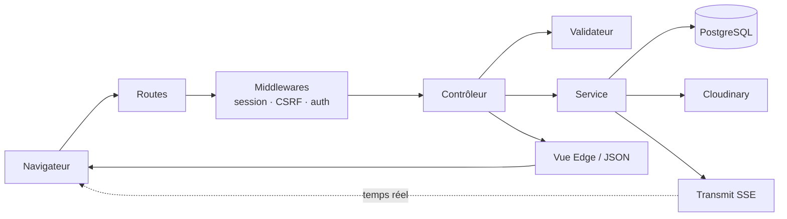

<div align="center">

# Kadea Chat

**Application web de messagerie : discussions privées, groupes et temps réel.**

Projet de fin de formation · Kadea Academy


[Démo en ligne](#liens-du-projet) · [Présentation](#liens-du-projet) · [Modélisation](#liens-du-projet) · [Architecture C4](#liens-du-projet) · [Installation](#installation)

</div>

---

## Sommaire

1. [Liens du projet](#liens-du-projet)
2. [Présentation](#présentation)
3. [Fonctionnalités](#fonctionnalités)
4. [Technologies](#technologies)
5. [Architecture](#architecture)
6. [Prérequis](#prérequis)
7. [Installation](#installation)
8. [Variables d'environnement](#variables-denvironnement)
9. [Commandes utiles](#commandes-utiles)
10. [Structure du projet](#structure-du-projet)
11. [Routes principales](#routes-principales)
12. [Base de données](#base-de-données)
13. [Sécurité](#sécurité)
14. [Tests](#tests)
15. [Déploiement](#déploiement)
16. [Problèmes fréquents](#problèmes-fréquents)
17. [Limites connues et évolutions](#limites-connues-et-évolutions)
18. [Auteur](#auteur)

---

## Liens du projet

| Ressource | Lien |
|---|---|
| Site en ligne | [`https://www.kadeaChat.com`](https://agora-chat-app-1.onrender.com/) |
| Présentation (Canva) | [`https://www.canva.com`](https://canva.link/6sky2nlgir7lk05) |
| Maquettes (Figma) | [`https://www.figma.com`](https://www.figma.com/design/hTThi75OAXNNjJtiz2gVSU/Kadea-Chat-Final?node-id=0-1&t=vpy0dWdvBXb6JpBq-1) |
| Modélisation (MCD / MLD / MPD) | [`docs/modelisation`](docs/modelisation) ou [`lien externe`](https://VOTRE-LIEN) |
| Architecture C4 | [`docs/c4`](docs/c4) ou [`lien externe`](https://VOTRE-LIEN) |
| Cahier des charges | [`docs/cahier-des-charges.pdf`](docs/cahier-des-charges.pdf) |
| Vidéo de démonstration | [`https://VOTRE-LIEN`](https://VOTRE-LIEN) |


---

## Présentation

**Kadea Chat** est une application de messagerie web conçue de A à Z : analyse, modélisation de la base de données, serveur, interface, sécurité et temps réel.

**Objectifs du projet**

- Proposer un espace de discussion simple pour une communauté (promotion, classe, équipe).
- Couvrir tout le cycle de développement : conception, base de données, serveur, interface, déploiement.
- Appliquer des règles de sécurité côté serveur (droits, validation, protection des comptes).

---

## Fonctionnalités

| Domaine | Détail |
|---|---|
| **Comptes** | Inscription en deux étapes avec confirmation par e-mail, connexion, mot de passe oublié par lien à usage unique |
| **Profil** | Photo, biographie, statut « En ligne », statistiques |
| **Messages privés** | Envoi, modification, suppression, accusés de lecture, compteur de non-lus, suppression de conversation pour soi |
| **Groupes** | Création, rôles administrateur / membre, ajout de membres, suppression par l'administrateur |
| **Temps réel** | Nouveaux messages, lectures, modifications et présence instantanés (SSE) |
| **Fichiers joints** | Images et documents jusqu'à 10 Mo, miniatures, ouverture et téléchargement |
| **Recherche** | Dans tous ses propres messages, avec mot surligné |
| **Utilisateurs** | Liste paginée, recherche, démarrage d'une discussion |
| **Blocage** | Un utilisateur bloqué ne peut plus écrire à celui qui l'a bloqué |
| **Paramètres** | Changement de mot de passe, liste des bloqués, suppression de compte avec règles de succession |
| **Interface** | Responsive, thème clair et sombre, chargeur, notifications, états vides |

---

## Technologies

| Couche | Outil | Rôle |
|---|---|---|
| Serveur | **AdonisJS 7** (TypeScript) | Routes, validation, authentification, sessions |
| Gabarits | **Edge** | Génération des pages HTML |
| Base de données | **PostgreSQL** + **Lucid** (ORM) | Stockage et requêtes |
| Validation | **VineJS** | Contrôle des données reçues |
| Styles | **Tailwind CSS 4** | Mise en forme, thème clair et sombre |
| Interface | **JavaScript (modules)** + **Vite** + **Alpine.js** | Interactions dans le navigateur |
| Temps réel | **Transmit** (Server-Sent Events) | Messages et présence instantanés |
| Fichiers | **Cloudinary** | Stockage des images et documents |
| E-mails | **Brevo** | Confirmation d'inscription, mot de passe oublié |
| Tests | **Japa** | Tests unitaires et fonctionnels |

---

## Architecture

### Parcours d'une requête



### Responsabilités

| Couche | Dossier | Rôle |
|---|---|---|
| Routes | `start/routes.ts` | Associer une adresse à une action, avec ses protections |
| Middlewares | `app/middleware/` | Autoriser ou refuser la suite de la requête |
| Validateurs | `app/validators/` | Vérifier la forme des données |
| Contrôleurs | `app/controllers/` | Orchestrer une action |
| Services | `app/service/` | Règles métier réutilisables |
| Modèles | `app/models/` | Tables et relations |
| Vues | `resources/views/` | Affichage (layouts, composants, partiels) |
| Scripts | `resources/js/` | Comportements côté navigateur |

> Les diagrammes détaillés (contexte, conteneurs, composants) se trouvent dans [`docs/c4`](docs/c4).

---

## Prérequis

| Outil | Version | Vérification |
|---|---|---|
| Node.js | **24 ou plus** | `node -v` |
| npm | fourni avec Node | `npm -v` |
| PostgreSQL | 14 ou plus | `psql --version` |
| Git | récent | `git --version` |
| Compte Cloudinary | gratuit | [cloudinary.com](https://cloudinary.com) |
| Compte Brevo | gratuit | [brevo.com](https://www.brevo.com) |

---

## Installation

### 1. Récupérer le projet

```bash
git clone https://github.com/VOTRE-COMPTE/kadea-chat.git
cd kadea-chat
```

### 2. Installer les dépendances

```bash
npm ci
```

### 3. Créer la base de données

```bash
psql -U postgres
```

```sql
CREATE DATABASE kadea_chat;
CREATE DATABASE kadea_chat_test;   -- pour les tests, jamais la même base
\q
```

### 4. Configurer l'environnement

```bash
cp .env.example .env
node ace generate:key
```

La seconde commande écrit une valeur `APP_KEY` unique dans `.env`. Complétez ensuite le fichier en suivant la section [Variables d'environnement](#variables-denvironnement).

### 5. Créer les tables et les données de référence

```bash
node ace migration:run
node ace db:seed
```

Le seeder insère les données **indispensables** au fonctionnement : types de conversation (`private`, `group`), types de message (`texte`, `images`, `document`, `video`, `emodji`) et rôles (`admin`, `membre`). Sans elles, la création d'une conversation échoue avec `E_ROW_NOT_FOUND`.

### 6. Lancer l'application

Ouvrez **deux terminaux** :

```bash
# Terminal 1 : serveur AdonisJS + Vite (rechargement à chaud)
npm run dev
```

```bash
# Terminal 2 : génération des styles Tailwind
npx @tailwindcss/cli -i ./resources/css/input.css -o ./resources/css/output.css --watch
```

L'application est disponible sur **http://localhost:3333**.

> Si une classe Tailwind « ne fonctionne pas », le terminal 2 n'est presque toujours pas lancé.

### 7. Premier test rapide

1. Ouvrez `/register`, créez un compte.
2. Cliquez sur le lien reçu par e-mail pour finaliser.
3. Créez un second compte dans une fenêtre de navigation privée.
4. Envoyez un message d'un compte à l'autre : il doit arriver sans recharger la page.

---

## Variables d'environnement

Copiez `.env.example` vers `.env`, puis renseignez :

```dotenv
# Node
TZ=UTC
PORT=3333
HOST=localhost
NODE_ENV=development

# Application
LOG_LEVEL=info
APP_KEY=                      # généré par `node ace generate:key`
APP_URL=http://localhost:3333

# Session
SESSION_DRIVER=cookie

# Base de données PostgreSQL
DB_HOST=127.0.0.1
DB_PORT=5432
DB_USER=postgres
DB_PASSWORD=votre_mot_de_passe
DB_DATABASE=kadea_chat

# E-mails (Brevo)
MAIL_MAILER=brevo
MAIL_FROM_NAME=Kadea Chat
MAIL_FROM_ADDRESS=adresse-verifiee@exemple.com
BREVO_API_KEY=votre_cle_brevo

# Cloudinary
CLOUDINARY_CLOUD_NAME=votre_cloud
CLOUDINARY_API_KEY=votre_cle
CLOUDINARY_API_SECRET=votre_secret
```

| Variable | Rôle | Remarque |
|---|---|---|
| `APP_KEY` | Chiffrement des cookies et sessions | Unique par environnement, jamais partagée |
| `APP_URL` | Adresse publique, utilisée dans les liens des e-mails | En production : l'adresse réelle en `https://` |
| `SESSION_DRIVER` | `cookie`, `database` ou `memory` | `memory` est réservé aux tests |
| `MAIL_FROM_ADDRESS` | Expéditeur des e-mails | Doit être **vérifiée** dans Brevo |
| `BREVO_API_KEY` | Clé d'API Brevo | Brevo → SMTP & API → Clés d'API |
| `CLOUDINARY_*` | Identifiants Cloudinary | Console Cloudinary → Tableau de bord |

> **Ne commitez jamais `.env`.** Il est déjà dans `.gitignore`. Si un secret a été publié par erreur, **changez-le** : le supprimer de l'historique Git ne suffit pas.

Toute nouvelle variable doit aussi être déclarée dans `start/env.ts`, sinon le démarrage ne la valide pas.

---

## Commandes utiles

| Commande | Effet |
|---|---|
| `npm run dev` | Serveur de développement avec rechargement à chaud |
| `npm run build` | Compilation pour la production (dossier `build/`) |
| `npm start` | Lancement du serveur compilé |
| `npm run lint` | Analyse du code (ESLint) |
| `npm run format` | Mise en forme (Prettier) |
| `npm run typecheck` | Vérification des types TypeScript |
| `npm test` | Tous les tests |
| `node ace test unit` | Tests unitaires seulement |
| `node ace migration:run` | Appliquer les migrations |
| `node ace migration:rollback` | Annuler le dernier lot de migrations |
| `node ace migration:fresh --seed` | **Efface tout** et reconstruit la base (développement uniquement) |
| `node ace db:seed` | Insérer les données de référence |
| `node ace list:routes` | Afficher toutes les routes |
| `node ace make:controller nom` | Générer un contrôleur |

---

## Structure du projet

```
kadea-chat/
├── app/
│   ├── controllers/        Un contrôleur par domaine (messages, groupes…)
│   ├── middleware/         auth, guest, auth silencieuse, liaisons du conteneur
│   ├── models/             Modèles Lucid (users, conversations, messages…)
│   ├── service/            Règles métier (Cloudinary, temps réel, groupes, suppression…)
│   ├── validators/         Schémas VineJS
│   └── exceptions/         Gestionnaire d'erreurs et pages 404 / 500
├── config/                 Réglages (base, session, hash, mail, Transmit, shield…)
├── database/
│   ├── migrations/         Création et évolution des tables
│   └── seeders/            Données de référence
├── docs/
│   ├── modelisation/       MCD, MLD, MPD
│   ├── c4/                 Diagrammes C4 (contexte, conteneurs, composants)
│   └── maquettes/          Exports des maquettes Figma
├── resources/
│   ├── css/                input.css (thème) → output.css (généré)
│   ├── js/                 Scripts de pages et temps réel (modules Vite)
│   └── views/
│       ├── components/     Composants réutilisables (layouts, bulles, avatars…)
│       ├── partials/       Fragments renvoyés par le serveur (panneaux de chat)
│       └── pages/          Pages complètes
├── start/                  routes, kernel, validator, view, transmit
├── tests/                  unit/ · functional/ · browser/
├── adonisrc.ts             Providers, preloads, suites de tests
└── vite.config.ts          Points d'entrée JavaScript
```

---

## Routes principales

| Méthode | Route | Rôle | Accès |
|---|---|---|---|
| GET / POST | `/register` | Inscription | Invité |
| GET / POST | `/signup/:id/:code` | Finalisation du compte | Invité |
| GET / POST | `/login` | Connexion | Invité |
| GET / POST | `/forgoPassword` | Demande de réinitialisation | Invité |
| GET / POST | `/forgoPassword/:id/:code` | Nouveau mot de passe | Invité |
| POST | `/logout` | Déconnexion | Connecté |
| GET | `/messages` | Liste des conversations privées | Connecté |
| GET / DELETE | `/conversations/:id` | Ouvrir / supprimer pour soi | Participant |
| POST | `/conversations/:id/messages` | Envoyer (texte et/ou fichier) | Participant |
| PUT / DELETE | `/messages/:id` | Modifier / supprimer | Auteur |
| POST | `/conversations/:id/read` | Marquer comme lu | Participant |
| GET / POST | `/groups` | Liste / création | Connecté |
| GET / DELETE | `/groups/:id` | Ouvrir / supprimer | Membre / admin |
| POST | `/groups/:id/members` | Ajouter des membres | Admin |
| POST | `/groups/:id/messages` | Écrire dans un groupe | Membre |
| GET | `/users` | Liste et recherche d'utilisateurs | Connecté |
| POST | `/users/:id/chat` | Démarrer une discussion | Connecté |
| POST | `/users/:id/block` · `/unblock` | Bloquer / débloquer | Connecté |
| GET | `/search?q=` | Rechercher dans ses messages | Connecté |
| GET / POST | `/profile` | Voir / modifier le profil | Connecté |
| GET | `/settings` | Paramètres du compte | Connecté |

La liste exacte et à jour s'obtient avec `node ace list:routes`.

---

## Base de données

Le modèle complet (MCD, MLD, MPD) est dans [`docs/modelisation`](docs/modelisation).

| Table | Contenu |
|---|---|
| `users` | Comptes utilisateurs, statut en ligne |
| `inscriptions` | Inscriptions en attente de confirmation (temporaire) |
| `forgo_passwords` | Demandes de réinitialisation (jeton haché, expiration) |
| `conversation_types` | Référence : `private`, `group` |
| `conversations` | Discussions privées et groupes (même table) |
| `role_conversations` | Référence : `admin`, `membre` |
| `user_conversations` | Participants, rôle, date d'arrivée, dernier message lu |
| `message_types` | Référence : texte, images, document… |
| `messages` | Messages, suppression douce (`is_deleted`) |
| `message_attachments` | Fichiers joints (nom, lien, type, taille) |
| `message_statuses` | Statut d'envoi et de lecture par destinataire |
| `message_recipients` | Destinataires explicites |
| `blocked_users` | Qui a bloqué qui |

**Choix de conception**

- Un seul modèle pour les conversations privées **et** les groupes.
- Les rôles sont stockés dans la table de liaison `user_conversations`.
- Une migration déjà appliquée n'est jamais modifiée : on en écrit une nouvelle.

---

## Sécurité

| Mesure | Détail |
|---|---|
| Mots de passe | Hachés, jamais stockés en clair |
| Liens secrets | Hachés, à usage unique, avec expiration (48 h inscription, 1 h réinitialisation) |
| CSRF | Jeton obligatoire sur tous les formulaires (`@adonisjs/shield`) |
| Validation | Toutes les entrées passent par VineJS côté serveur |
| Droits | Vérifiés par le serveur : 404 pour un non-membre, 403 sans droit |
| Injection SQL | Requêtes paramétrées (Lucid / Knex) |
| XSS | Échappement du HTML (`{{ }}` d'Edge), jamais de HTML fabriqué à partir d'un texte utilisateur |
| Cookies | `httpOnly`, `sameSite=lax`, `secure` en production |
| En-têtes | HSTS, anti-clickjacking, anti-sniffing |
| Réponses neutres | Connexion et blocage ne révèlent rien d'inutile |
| Actions sensibles | Mot de passe redemandé pour supprimer le compte |

**Signaler une faille :** contactez l'auteur par e-mail (voir [Auteur](#auteur)) plutôt que d'ouvrir une issue publique.

---

## Tests

```bash
npm test                  # toutes les suites
node ace test unit        # tests unitaires
node ace test functional  # tests de routes (base de test)
```

- Les tests utilisent la base `kadea_chat_test`, **jamais** la base de développement.
- Chaque test suit le schéma **Préparer → Agir → Vérifier**.
- Priorités : droits sur les conversations et groupes, règle de blocage, isolation de la recherche, succession d'administrateur à la suppression d'un compte.

---

## Déploiement

```bash
npm ci
node ace build
cp .env build/.env                 # puis adapter les valeurs de production
cd build
npm ci --omit=dev
node ace migration:run --force
node ace db:seed
node bin/server.js
```

**Liste de contrôle avant la mise en ligne**

- [ ] `NODE_ENV=production`
- [ ] `APP_KEY` neuve et secrète
- [ ] `APP_URL` en `https://` avec l'adresse réelle
- [ ] HTTPS actif chez l'hébergeur
- [ ] `SESSION_DRIVER` sur `cookie` ou `database` (pas `memory`)
- [ ] Clés Cloudinary et Brevo définies dans les variables de l'hébergeur
- [ ] Adresse d'expédition vérifiée dans Brevo
- [ ] Sauvegarde automatique de PostgreSQL **et** test de restauration
- [ ] Processus géré par `pm2`, `systemd` ou Docker (redémarrage automatique)
- [ ] Limitation du nombre de tentatives sur `/login`, `/forgoPassword`, `/register`

Consultez la documentation officielle « Deployment » d'AdonisJS pour les chemins exacts de la version 7.

---

## Problèmes fréquents

| Symptôme | Cause probable | Solution |
|---|---|---|
| Une classe Tailwind n'a aucun effet | Le terminal Tailwind n'est pas lancé, ou la classe est assemblée par morceaux | Lancer la commande `--watch` ; écrire les noms de classes en entier |
| `E_ROW_NOT_FOUND` à la première conversation | Données de référence absentes | `node ace db:seed` |
| Le message n'arrive pas en direct | `start/transmit.ts` absent de `preloads` dans `adonisrc.ts` | Vérifier la liste des preloads |
| `E_BAD_CSRF_TOKEN` (403) | Session expirée ou jeton absent du formulaire | Recharger la page ; vérifier `{{ csrfField() }}` |
| Aucun e-mail reçu | Expéditeur non vérifié dans Brevo, ou clé invalide | Vérifier `MAIL_FROM_ADDRESS` et `BREVO_API_KEY` |
| Image refusée | Fichier trop lourd ou extension non autorisée | Maximum 10 Mo, extensions listées dans `app/validators/message.ts` |
| Erreur de contrainte à la suppression d'un compte | Une autre table référence `users` sans cascade | Lire le nom de la contrainte dans l'erreur |
| Une fonction JavaScript est « introuvable » dans un autre fichier | Elle n'est pas exportée | Ajouter `export` et `import` |
| Un script de page ne se charge pas | Absent de `entryPoints` | Le déclarer dans `vite.config.ts` |
| Erreur au démarrage sur une variable manquante | Variable absente de `.env` | Comparer avec `.env.example` et `start/env.ts` |

---

## Limites connues et évolutions

**Limites actuelles**

- Présence en ligne et temps réel conçus pour **un seul processus serveur**.
- Recherche en `ILIKE '%…%'` : suffisante pour un projet de formation, lente à grande échelle.
- Pas de limitation du nombre de tentatives de connexion.
- Envoi des e-mails pendant la requête (pas de file d'attente).
- Couverture de tests partielle.
- Liens des fichiers publics (non devinables, mais non signés).

**Évolutions prévues (V2)**

- [ ] Chiffrement de bout en bout des messages
- [ ] Redis pour la présence et le temps réel multi-serveurs
- [ ] Limiteur de débit sur les routes d'authentification
- [ ] Tests automatisés complets (Japa)
- [ ] Contrainte `UNIQUE` sur `blocked_users`, colonnes `nullable` pour l'anonymisation à la suppression d'un compte
- [ ] Recherche optimisée (`pg_trgm`) et saut jusqu'au message trouvé
- [ ] Appels audio et vidéo, réactions, messages vocaux

---

## Auteur

**[Votre nom]**
Étudiant · Kadea Academy
E-mail : [votre@email.com](mailto:votre@email.com)
GitHub : [@VOTRE-COMPTE](https://github.com/VOTRE-COMPTE)
LinkedIn : [Votre profil](https://www.linkedin.com/in/VOTRE-PROFIL)

---

<div align="center">

© 2026 Kadea Chat · NMS Tech · Tous droits réservés

</div>
